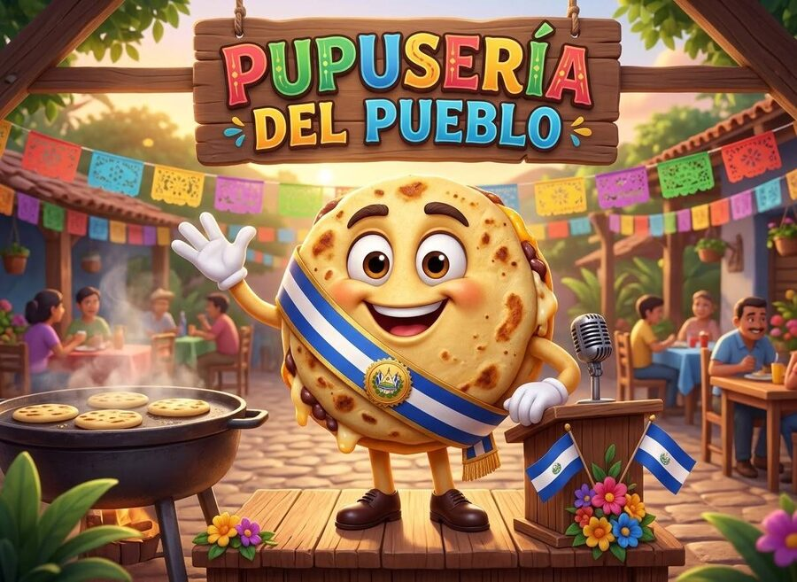

# Pupusería del Pueblo

Juego de cocina contra reloj y política: sos dueño de una pupusería y alcalde ("alcalde Pupusa"). Las ganancias arreglan tu municipio, y de ahí escalás a líder departamental, candidato y **Presidente Pupusa**. Los clientes y votantes son personas de **nvidia/Nemotron-Personas-El-Salvador** (CC-BY-4.0). Todo corre en el navegador: sin API ni modelos en línea.

## Cómo correrlo (doble clic)
1. Descomprimí la carpeta.
2. Para usar los datos reales: doble clic en `GENERAR_DATOS_WINDOWS.bat` (o `GENERAR_DATOS_MAC.command`). Necesita Python e internet; descarga Nemotron y crea `data/clientes.json` y `data/clientes_data.js`.
3. Doble clic en `index.html`: el juego abre en el navegador, sin servidor.
Sin el paso 2 el juego usa 12 clientes de ejemplo.

## Modo en línea (ranking y duelos)
Con Node.js instalado (nodejs.org):
- **Misma WiFi:** doble clic en `ABRIR_JUEGO_CON_SERVIDOR.command` (Mac) o `ABRIR_JUEGO_CON_SERVIDOR_WINDOWS.bat`. Abre `http://localhost:3000`; los celulares entran con la IP que muestra la ventana.
- **Link público (cualquier celular, aunque sea con datos):** `ABRIR_JUEGO_EN_LINEA.command` o `ABRIR_JUEGO_EN_LINEA_WINDOWS.bat` (usa cloudflared). Comparte el link que aparece.
- En el menú salen **⚔️ Duelo en línea** (sala con código y QR, hasta 8 jugadores, mismo día de 2 minutos con los mismos clientes; gana quien junte más) y **🏆 Ranking** (mejor día, presidente más rápido, duelos), guardado en `records_*.json` en el servidor.
- Para desplegar en Render/Railway/Fly: build `npm install`, start `npm start`, variable `PORT`.
Sin servidor el juego funciona igual con doble clic en `index.html`, solo sin esos dos botones.

Atajos: `index.html?demo` abre el modo demo (campaña avanzada para mostrar todo en 3 minutos).

## Qué tiene
- Cocina 2D: 5 rellenos, curtido, bebidas por edad, propinas, combos, ayudante y mejoras.
- 14 alcaldías (una por cabecera departamental), cada una con mapa 3D propio, monumento emblemático y 6 obras por resolver.
- Eventos del día, mecánica por departamento y dilemas del alcalde.
- Periódico "El Diario del Pueblo": avance cada 3 días, ranking presidencial cada 5, titular y noticias flotantes para cada cambio.
- Elecciones internas, peticiones ciudadanas, primarias y presidenciales votadas por clones de las personas del dataset (panel "Tu electorado").
- Historia con Doña Chelita, la rival, el Cipitío y la Siguanaba; sonido sintetizado; guardado automático; tarjeta para compartir.

## Archivos
- `index.html`: página y estilos. `js/game.js`: cocina, campaña, periódico y elecciones. `js/extras.js`: eventos, dilemas, mejoras, historia, sonido, guardado, demo y tarjeta. `js/town3d.js` + `js/gl.js` + `js/lib/three.min.js`: mapas 3D. `js/clientes.js`: carga de clientes. `js/online.js` + `server.js`: ranking y duelos en línea.
- `scripts/01_generar_clientes.py`: genera `data/clientes.json` (uuid, age, sex, occupation, municipality, department, area, pedido, education_level, persona).

## Formato de `data/clientes.json`
Campos obligatorios: `age`, `sex`, `occupation`, `pedido` (uno de `frijol con queso`, `queso`, `ayote`, `chicharrón`, `queso con loroco`). Opcionales: `uuid`, `municipality`, `department`, `area`, `persona`, `avatar`.

## Créditos
Datos: Nemotron-Personas-El-Salvador (NVIDIA, CC-BY-4.0). Gráficos 3D: three.js.

## Cabildo abierto (v27)
La gestión de la alcaldía ahora es un cabildo: cada día llegan 3 personas reales del dataset con su historia; decidís en qué gastar la caja y el pueblo 3D cambia según el estado de salud, educación, agua, calles, economía y seguridad.

## Lujo SV (lujo.html)
Abrí `lujo.html` (doble clic) para el simulador de precios de experiencias de lujo: ajustá precios y ves alcance, clientes, ingreso y ganancia estimados con los perfiles de Nemotron. Corré antes `scripts/01_generar_clientes.py` para usar el dataset real (con la muestra de ejemplo de 12 perfiles no es representativo).

## Novedades (v31)
- Pueblo en bloques estilo Minecraft, distinto por departamento, con vecinos en la plaza para atenderlos.
- Pupusa rediseñada y salsa obligatoria (botella roja).
- Cada departamento tiene su propia escena en la pupusería.
- Metas de 3 estrellas, hora pico, clientes VIP, combos y reacciones locales.
